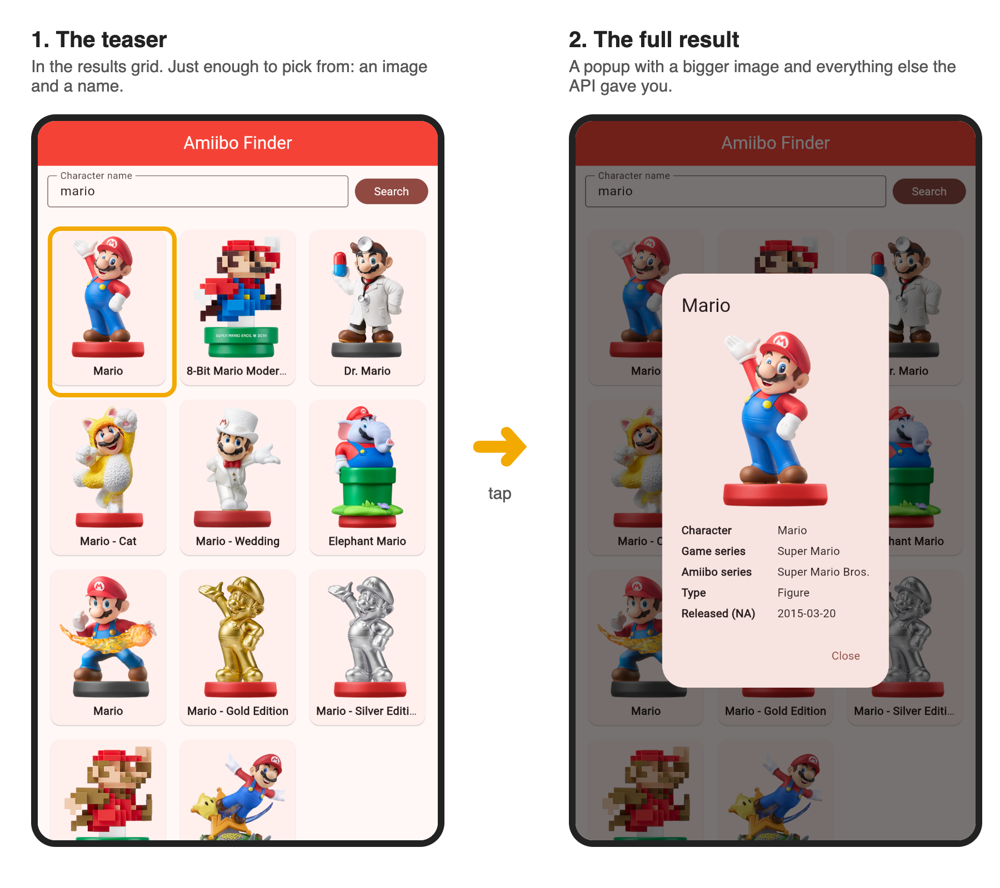

# Project 2 - Web Service Application

> **Updated Oct 19:** your Project 2 code now goes in a GitHub repo instead of a zip, one repo for both the prototype and the final. The dropboxes take a short document with your repo link. See [Your Code Goes in a GitHub Repo](#your-code-goes-in-a-github-repo).

## I. Overview

For this project you are creating a Flutter Application that utilizes a Web service.
- Your goal is to create an application that is easy to use, functional, and aesthetically pleasing.
- **It must run on Android.** That's the default, and the Android emulator is where I grade it. Flutter can also build for iOS, Mac, and Windows, and it's great if yours runs there too. But if you want to target one of those *instead of* Android, get my approval before you start.
- The objective of this project is for you to demonstrate your mastery of Flutter and Dart programming.
- You will be evaluated on:
    - how well you met the requirements of the assignment.
    - the quality of the experience you create.
    - the soundness of your programming.

### What You Turn In

Three deliverables, each with its own dropbox in MyCourses. Due dates are there too.

| Deliverable | What it is | Share of the P2 grade |
|---|---|---|
| [Proposal](#iv-proposal) | Your API, proof it works, what your app will do, and a mockup | 15% |
| [Prototype App](#v-prototype-app) | A rough, working version of your app: your API call works and results show on screen | 5% |
| [Final App](#vi-final-app) | The finished app plus a short PDF | 80% |

A clean, working app that meets every requirement and is pleasant to use will grade well. You don't need a pile of extra features to get there. Pick an API, show its data clearly, and pick **one thing** to do really well, whether that's the layout, a really polished popup when you tap a result, or how the app handles errors.

### Your Code Goes in a GitHub Repo

No zip this time. Your Project 2 code lives in a private GitHub repo, set up the same way as the participation repos. The MyCourses dropboxes take only a short document: a reflection for the prototype, and the PDF for the final.

1. **Get your repo** from the link at the top of the Prototype App dropbox in MyCourses. Accepting it creates a repo just for you, `igme-340-project-2-<your-github-username>`, with a plain Flutter app already in it. **It's one repo for both the Prototype App and the Final App.** Keep working in it after the prototype; there's no second repo.
2. **Already started?** Copy your work into the new repo. Its README walks you through it.
3. **Commit and push as you go.** Push whenever something works: your first API call showing results, the grid, each new control. Your commit history is how I see your app come together. A whole project that arrives in one commit the night it's due is hard to tell apart from code that came from somewhere else, and that's when I'll ask you to walk me through it. It also counts toward your grade (see [How the Final Is Graded](#how-the-final-is-graded)).
4. **I grade what's pushed by each due time.** If it's only on your laptop, I can't see it.

Your repo is private, so if your API needs a key, leave it in. I need it to run your app. (OMDb keys can't be cancelled, so if you ever make the repo public, the worst case is someone using up your free 1,000 requests a day.)

> **Project Scope & Success:** These projects are substantial, but manageable with proper planning. I've provided extensive code examples in our [Reference Manual](../reference/README.md), including complete implementations like the [shared preferences guide](../reference/data-persistence/shared-preferences.md).
>
> **Time Management:** Plan for 6 to 9 hours of outside work weekly, which is standard for a 3-credit course. [I'm not making this up :)](https://www.humboldt.edu/sites/default/files/learning-center/2024-11/studyratiorecommendations.pdf). Starting early gives you time to create A-quality work and impressive portfolio pieces. Unlike unpredictable exams, you control your project outcomes through consistent effort. Last-minute starts typically lead to poor results and unnecessary stress.

## II. Choosing an API

You have two ways to go:

- **The easy path: pick from the list below.** Every API on it was checked in October 2026. Each one has a real search, filters you can combine in one URL, and an image in every result. If you want a solid project done well without fighting your API, start here.
- **Your own pick.** Any public API is allowed, and if there's one you're excited about, go for it. You'll need to check it carefully first (see [Picking Your Own API](#picking-your-own-api)), and **talk to me before you submit your proposal** so we can make sure your controls will actually work.

Either way, your proposal needs a screenshot showing the API returning data (see [Section IV](#iv-proposal)). APIs go down without warning, and this is how you find out early.

### Recommended APIs

- **AmiiboAPI** (https://www.amiiboapi.org/docs/#amiibo): search amiibo by name and filter by type (figure, card, yarn), game series, amiibo series, and character. Image in every result. No auth required.
- **Rick and Morty API** (https://rickandmortyapi.com/documentation): search characters by name and filter by status, species, and gender, all in one URL. Start with the `/character` endpoint; locations and episodes have fewer filters. Image in every result, and paging is built in. No auth required.
- **iTunes Search API** (https://performance-partners.apple.com/search-api): search music, podcasts, and more by term, and narrow by media type, entity (song, album, artist), country, and number of results. Album art in every result except artist searches, so search songs or albums. A movie search came back empty when we checked (use OMDb below for movies), so test your media type first. No auth required.
- **OMDb, the Open Movie Database** (https://www.omdbapi.com/): search movies and TV shows by title and narrow by type (movie, series) and year. Poster in almost every result. Needs a free API key: sign up with your email, then **click the activation link in that email**, or every request says "Invalid API key!"
- **NASA Image and Video Library** (https://images.nasa.gov/docs/images.nasa.gov_api_docs.pdf): search NASA's photo archive by keyword and narrow by media type and year range. Every result links to an image. The JSON is nested a few levels deep, so the "clean up the data" step from Lab 04 really pays off here. No auth required.
- **Disney API** (https://disneyapi.dev/docs/): search Disney characters by name and filter by the films or shows they appear in. Image in every result. No auth required. The first request after a quiet stretch can take a few seconds, so make sure your loading indicator works.
- **CheapShark** (https://apidocs.cheapshark.com/): search PC game deals by title, set a max price, and sort by price, rating, and more. Thumbnail in every result. No auth required.
- **TCGdex** (https://tcgdex.dev/): the Pokémon pick. See [Popular APIs That Cause Trouble](#popular-apis-that-cause-trouble) below for why it beats PokeAPI.
- ~~**Jikan (MyAnimeList) API v4** (https://docs.api.jikan.moe/): search and filter anime/manga by title, type, score, status, rating, genre, and more.~~ **Down as of Oct 8, 2026:** every request timed out. It has worked well in past semesters, so I'll put it back if it returns. If you want it, check it in Hoppscotch first and have a backup in mind.

### Picking Your Own API

There are **hundreds** of free public APIs out there: animals, anime, books, food, games, movies and TV, music, science, sports, and a lot more. **Start with [Public API Lists](https://github.com/public-api-lists/public-api-lists)**, a big categorized directory we'll look at together in class.

Look for APIs where the **Auth** column says `No` or `apiKey`. Those are the easiest to get running. An API key is totally fine (and good real-world practice), just make sure you can actually get one before your proposal.

Then, before you commit, try a few searches in Hoppscotch and check for these four things:

- **Images.** Each result should include an image URL (see [Images](#a-functional)). No images? Talk to me, and we can work out an alternative.
- **A real search.** Some APIs are *lookup* APIs: you can ask for one exact item by name or ID, but a partial name gives you an error or nothing instead of a list of matches.
- **Filters that combine.** You want to search and filter in the same request. Some APIs only let you filter by one thing at a time, and some quietly ignore extra parameters, so check that your results actually changed.
- **Full results.** If a search only gives you a name and an ID, showing an image or any details means one more request per item.

You can work around a weak API on the device. Sorting what came back (A to Z, newest first) is easy. But filtering on something the API can't search usually means downloading far more results than you show and sorting them out yourself, which is real extra work on top of the project. See [Required Controls](#a-functional) for what counts as a control.

### Popular APIs That Cause Trouble

These show up every semester and fail the checks above. They're allowed, but you'll be fighting them. If you still want one, talk to me before your proposal.

- **PokeAPI:** only exact names work (`/pokemon/pika` is a 404), the only URL options are `limit` and `offset`, and list results are just names and links, so every sprite is one more request. Past students have fired off over a thousand requests at once. **Want Pokémon? Use [TCGdex](https://tcgdex.dev/) instead.** It's a trading card API with partial-name search and filters like type and HP, and a student used it last semester with great results.
- **The Dog API:** images only, no search or filters.
- **TheMealDB / TheCocktailDB:** filters don't combine with each other or with a search, and a search returns at most 25 results.
- **REST Countries:** the version past students used was shut down in 2026. The new one needs a key and works differently.

## III. Requirements

### A. Functional
1. Use one of the APIs above (or one of your choosing) to create an experience similar to [GIF Finder](../labs/lab-04-gif-finder.md) that meets the requirements below. Lab 04 walks through the whole search function step by step, and your Project 2 search function should have the same shape: build the URL from your controls, send the request, check the status, catch errors, clean up the data, and hand it to the screen.

2. **Saved State:** Save the last term searched by the user in the device's shared_preferences.
    - We will test this by typing in a search term, doing a search, and then closing the application. When we re-open the app, the user's last search term should still be in the field.
    - Ideally this will also be true of the other controls, but we won't require it.
    - If there isn't a "search term" to save in your project, then save something else and be sure to document what is saved from visit to visit.

3. **Required Controls:** At least 3 controls that change what the user sees. Your search field counts as one, so that means a search field plus two more. The Search button itself doesn't count. Your Lab 04 GIF Finder already has two:
    - a search term field that the user types into
    - a dropdown that limits the number of results

    A results-count dropdown like Lab 04's counts for Project 2 too, **so you only need one new kind of control.** What kind depends on what the API lets you search on. Here are some ideas:
    - a **rating** pulldown: if Lab 04 had one, a user could choose between "G" and "PG" GIFs, for example
    - a **sort by** pulldown to allow the user to view the results sorted A->Z, Z->A, by date, etc
    - a **date** chooser to filter the results by date. A Datepicker Widget would be an excellent choice here
    - **next** and **previous** buttons. Another really nice option is to allow the user to "page" through large numbers of results. In Lab 04, did you notice that searching "cat" always brings back the same GIFs? There are ***thousands*** of cat GIFs on GIPHY, and if we don't otherwise specify, the web service always starts at index 0, so we always get the first 25 (index 0-24) back. We can instead write code that requests a higher starting index.

    **A control can work on the device, not just in the URL.** If your API has no parameter for something, you can still offer it by working with the results you already got back: sort them (A to Z, newest first) or filter what's on screen (only show items that have an image). Those count toward your 3. This is also how an API with only a couple of URL options can still work for this project. Sorting what you got back is the easy version. Filtering on something the API can't search on often means fetching far more results than you show, so plan for that before you pick the API.

4. **Images:** Your API should return images for its results (a photo, cover art, a character, a flag, and so on), and your app should display them with `Image.network`, the same way we did in [4A](../weekly/4A.md) and Lab 04. Images are a big part of what makes this feel like a real app.
    - **Found an API you're excited about that has no images?** Come talk to me before you submit your proposal. I'm happy to work out an alternative requirement with you so you can still build what interests you.

### B. Design & Interaction
- Pleasing graphic design:
  - Show me the cool things you can do in Flutter.
  - The interface does not closely resemble Lab 04's GIF Finder
- **Teaser first, then the full result:** each item in your results list or grid is a *teaser*: an image and a name or title, just enough to pick from. Tapping a teaser opens the *full result* in a popup (`showDialog` with an `AlertDialog`, like [4B](../weekly/4B.md)), with a bigger image and the rest of the details. Don't cram every field into the grid. If your API only returns a little data, the popup can be simple, but tapping a result should always show more. *(This was a common issue in past semesters.)*

  

- **Well-labeled controls:** Every input should have a clear label or hint text so users know exactly what to type or select. Don't make users guess what a field expects.
- **Use the right control type for the job:** If a filter has a fixed set of options (e.g., amiibo types, meal categories, content ratings), use a **DropdownButton**, not a TextField where the user has to type a value and hope it matches exactly. TextFields are great for open-ended search terms, but dropdowns prevent typos and make your app much easier to use. *(This was a common issue in past semesters, so don't lose points over it!)*
- Widgets follow interface conventions, for example:
  - radio buttons are for mutually exclusive options, checkboxes are for when you want to let the user choose *multiple* options.
- Users should be able to figure out how to use the app with minimal instruction:
  - be sure to provide instruction and hints if necessary
- **Basic input validation is expected:**
  - Don't let users submit empty searches. Show a message like "Please enter a search term first"
  - If a field requires specific input, validate it before making the API call
  - Display user-friendly error messages (not crashes or silent failures)
- Users must know what *state* the app is in at all times:
  - for example, when they click the search button, there should some indication that a search is happening:
    - text that says "Searching for 'Tacos' near you" and so on
    - a "spinner" or other "indeterminate progress" animation
- **A short About popup:** your name, plus a credit and link to the API you used. An info icon in the AppBar that opens it works well. Flutter's built-in `showAboutDialog` does most of the work for you.

#### Bonus: Form Polish (up to +5 points)

Want a few extra points? Implement professional form behaviors that real-world apps use. These small touches show attention to detail and can either push you past 100 or make up for a rough spot elsewhere. See [Week 7A](../weekly/7A.md) for how to implement these:

- **Clear (X) buttons** on TextFields so users can quickly reset input
- **Focus node management:** pressing the keyboard's next/enter button jumps to the next field
- **Tap-outside keyboard dismissal:** tapping outside a TextField closes the keyboard (standard iOS/Android behavior)

**To receive bonus points, you must document what you implemented** in your PDF (see [The PDF](#the-pdf) in Section VI) so I know to look for it.

### C. Code Conventions

**Graded on every project:**
- **Comments.** Project 1 was graded leniently on this. **Project 2 is not.** Functions without comments cost you points. Three rules (see the [Commenting Guide](../commenting_guide.md) for examples):
  - A header block at the top of every `.dart` file: what it does, your name, the date
  - One line above every function saying what it does
  - One line on anything non-obvious saying **why**
- **Clear names that follow Dart's conventions:** `UpperCamelCase` for classes, `lowerCamelCase` for variables, functions, and constants, and `lowercase_with_underscores` for file names. A name should tell you what it holds or does: `searchResults` beats `data2`.
- **Don't repeat yourself (DRY).** If nearly the same block of code shows up more than once (three dropdowns built the same way, for example), pull it into a function and call it.

**Worth doing as your app grows (not required):**
- Pull big chunks of your widget tree into their own widget classes, so `build()` stays readable.
- Give specific jobs their own `.dart` files, like your API code in `api_service.dart`.

## IV. Proposal

**Due Date:** See MyCourses for due date/time.

Your proposal document must include:

### 1. API and Proof It Works (Required)
- **API name and documentation link** (ex: https://developers.giphy.com/docs/)
- **A screenshot of a successful call** showing the JSON that comes back. Every API needs this, recommended ones included, because APIs go down without warning. Any of these works:
  - **Hoppscotch:** paste an endpoint into [Hoppscotch](https://hoppscotch.io/), hit Send, and screenshot the response.
  - **Your own Flutter code:** a search function that prints the JSON, with the debug console in the screenshot. If you've started your Lab 04-style search already, this is the most convincing proof there is.
  - **Your browser:** if the API doesn't need a key, open the endpoint URL in a browser tab and screenshot the JSON. (A few, like iTunes, download a file instead of showing it. Use Hoppscotch for those.)

  Not sure your screenshot counts? Ask me.

If you're using an API that isn't on the [recommended list](#recommended-apis), talk to me before you submit (see [Section II](#ii-choosing-an-api)). Office hours or Slack both work, just not the night before it's due.

### 2. Application Purpose (Required)
In 2-3 sentences, describe:
- What problem does your app solve?
- Who is the target user?
- What makes it useful or engaging?

**Example:** "Amiibo Shelf helps collectors see what exists before they buy. Users search by character name and narrow it down by type and game series, so they can see everything from one game at a glance and keep track of what they already own."

### 3. Core Functionality Description (Required)

Copy these questions into your proposal and answer each one. See [Required Controls](#a-functional) for what counts as a control, and [Picking Your Own API](#picking-your-own-api) for why Q4 matters.

**Q1. What do users type into the search field?**

A:

**Q2. What is your second control (dropdown, radio buttons, etc.), and what does it change?**

A:

**Q3. What is your third control, and what does it change?**

A:

**Q4. Do your second and third controls go into the request URL, or do they work on the device? (In the URL means the API does the filtering, like adding `&type=figure`. On the device means you get the results back and sort or filter them yourself.)**

A:

**Q5. What gets saved between sessions? (Likely the search term. We cover shared_preferences in Week 9.)**

A:

**Q6. Which field in the API's response holds the image?**

A:

**Example answers (Amiibo app):**

- **Q1:** A character name, like "mario."
- **Q2:** A dropdown for type: figure, card, or yarn.
- **Q3:** A dropdown for game series.
- **Q4:** Both go into the URL.
- **Q5:** The last search term.
- **Q6:** `image`

### 4. Visual Mockup (Required)
At least one mockup of your main screen: a hand-drawn sketch, a wireframe (Figma, Balsamiq, etc.), or an annotated screenshot of a similar app. Label where the inputs go, how the results will look, and any navigation if your app has more than one screen.

### Proposal Submission
1. **Document Format:** Submit as PDF or Word document
2. **File Naming:** `LastName_FirstName_P2Proposal.pdf`
3. **MyCourses:** Upload to the Project 2 Proposal dropbox
4. **Slack:** Share it in the class Slack channel for feedback

### How the Proposal Is Graded
Four parts, one per numbered section above, 2.5 points each. The rubric is attached to the Project 2 Proposal dropbox.

## V. Prototype App

A check-in partway through, so I can catch problems while there's still time to fix them.

### What to Do
- At minimum, your app calls your API and shows the results on screen. Rough is fine: plain styling, half-wired controls, and placeholder text are all OK at this stage.
- Stuck on something? Say so in your reflection. That's the most useful thing you can tell me right now.

### What to Submit
1. **Push your code** to your Project 2 repo before the deadline. That's what I run.
2. **Upload a short reflection** to the Project 2 Prototype App dropbox, named `LastName_FirstName_P2Reflection.pdf` (Word is fine too). Your repo's link at the top, then a paragraph or two on where the project stands:
    - what works so far, and what doesn't yet
    - what you're stuck on, if anything
    - what you'll do between now and the final
    - AI tools used and what for, or "None" (see [Generative AI](../documents/syllabus.md#generative-ai-eg-chatgpt) in the syllabus)

### How the Prototype Is Graded
With a small rubric, *Prototype Check*: does it run, and does the core work. A missing reflection costs 2 of the 10 points. The full Project 2 rubric is linked at the top of the Prototype App dropbox so you can see what the final is graded on. A 10/10 on the prototype means you're on track. It doesn't mean the final is headed for 100.

## VI. Final App

Your finished app, pushed to the same repo you used for the prototype, plus a short PDF uploaded to the Project 2 Final App dropbox.

### What to Submit
1. **Your code**, pushed to your Project 2 repo before the deadline. No zip.
2. **Your PDF**, named `LastName_FirstName_P2Doc.pdf`, uploaded to the dropbox (see below).

### The PDF
Keep it short, about a page, with your repo's link at the top. This is what I read while grading, so it helps me find everything and give you credit. Three sections:

1. **How to Use Your App:** a quick walkthrough. What should I search for, what do the controls do, and is there anything I should try?
2. **How You Met the Requirements:** where your 3 controls are, what you save with shared_preferences, and anything extra you want me to notice, including any bonus items.
3. **AI Tools Used:** which ones and what for (see [Generative AI](../documents/syllabus.md#generative-ai-eg-chatgpt) in the syllabus). If you didn't use any, write "None." This section is required either way.

### How the Final Is Graded
The grading rubric for this project is visible in MyCourses. You should look it over carefully. Find it by going to the "Assignments" section and clicking through to the "Project 2 Final App" dropbox. It follows the requirements in [Section III](#iii-requirements) closely.

**Commit history counts too.** I want to see your app come together over time, so your repo needs at least 5 commits of your own. Fewer than that costs up to 10 points, taken off after the rubric. Your first commit can be a big one if you brought in work you'd already started.

> **Need Help?**
> Start with your own [Lab 04](../labs/lab-04-gif-finder.md). Its `searchGifs()` function is the pattern, step by step, and your Project 2 search function will look a lot like it with a different URL and different fields. The references area also has extensive documentation on how to [connect to Giphy](../reference/network/giphy-api-setup.md). Much of the code you need may end up being similar in nature to this; but the way you interact and build it will be different. In a sense we are providing you with much of the ingredients; but you need to creatively assemble and build the meal.
