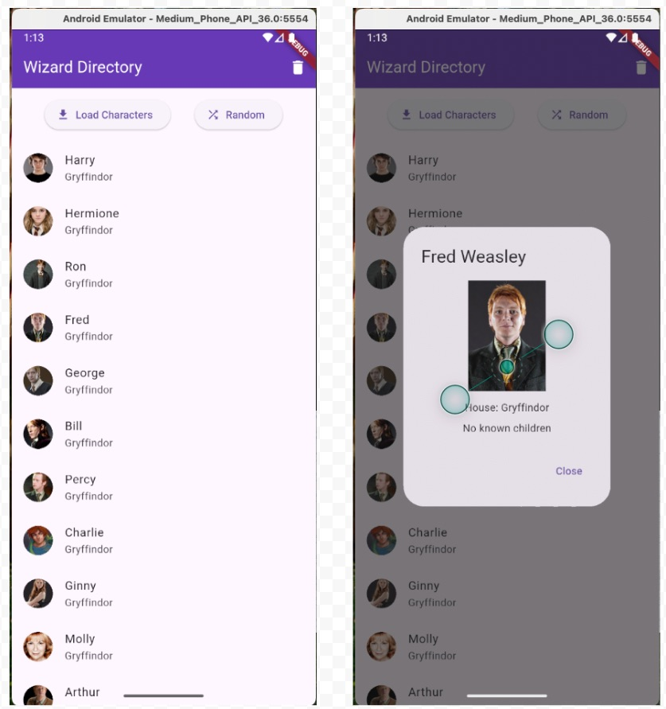
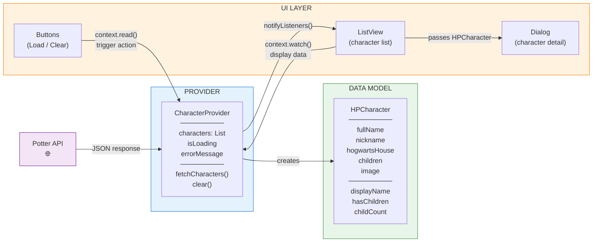

# Week 10B - Provider From Scratch: Wizard Directory

## Important Context for Students

**This guide serves as both teaching notes and your class reference.** Unlike earlier weeks where we provided partial code for you to assemble, this guide includes complete code solutions. This is intentional as we're entering more complex territory.

### About Advanced Topics

I know project 2 is fresh on everyones mind, but I am bringing up Project 3 now because we will need to add some advanced features; we have covered much of the core stuff, and want people to have in the back of their mind potential things they can use down the road. We have some time but its coming up soon nonetheless:

- **[Project 3 draft](../projects/p3_roll_your_own_instructions.md) is now available** - review it to understand your options
- Project 3 is open-ended: you can build a game OR an advanced app
- Basic requirements will get you to 85-90%
- **To reach 100%, you'll need to implement 1-2 advanced topics** we cover in the coming weeks
- Provider is ONE of those advanced topics you could choose

### Why Cover This If It's Optional?

Even though things are getting more complex and **our app won't look different to end users**, these techniques help you:
- Build more robust, maintainable applications
- Separate concerns in your code architecture
- Handle state management at scale
- Develop professional-grade Flutter skills

**You're not expected to use every advanced topic we cover** - just pick 1-2 that fit your Project 3 vision.

### Participation for This Week

Push before the start of class on **Tuesday Nov 3**. Your pushed code has to show:
- an `HPCharacter` class and a `CharacterProvider` that fetches the characters
- Load Characters fills the list, and the trash can empties it
- tapping a character opens a popup with their details

Part 6 (loading and errors) isn't required for credit. It's the same thing Project 2 is graded on, though, so it's worth doing.

---

## Overview
- **Topic:** Building an API-driven app with Provider from the start
- **Estimated time:** 75 minutes
- **Quick Reference:** See the [Provider Pattern Reference Guide](../reference/state-management/provider-pattern.md) for patterns and syntax
- **Related:** This builds on [Week 10A](10A.md) concepts - same Provider package, new application (API calls instead of button clicks)
- **Prerequisites:**
  - Basic Provider concepts from Week 10A
  - Your [Lab 04](../labs/lab-04-gif-finder.md) search function. Today's fetch is the same shape.

### Learning Objectives
By the end of this lesson, you will be able to:
- Plan an app's architecture before writing code (model, provider, UI)
- Create a data model class with computed properties
- Build a Provider that handles async API calls
- Use `context.read()` for actions and `context.watch()` for reactive display
- Reuse a model object in multiple contexts (list view and detail dialog)
- Keep loading and error state in the provider, where any widget can watch it

### The Lesson from 10A

Remember last class? We built the clicker game the old way (globals + setState), then spent most of class painfully converting it to Provider. The takeaway was clear: **it's always easier to build it right the first time than to rewire everything later.**

Today we put that lesson into practice. We're going to **plan the architecture first and build with Provider from the start.**

The networking part is old news. You wrote a full search function in Lab 04: build the URL, send the request, check the status, clean up the data, hand it to the screen. Today's fetch is that same function with two changes. It lives in a provider instead of the widget, and it builds real objects instead of Maps.

---

## Part 1: Plan Before You Code (~5 min)

### STEP 1: Understand What We're Building

**The App: Wizard Directory**
- Fetches Harry Potter characters from a free API
- Displays a scrollable list with character images, names, and Hogwarts houses
- Tap any character to see their full profile in a dialog
- Clear button resets the list



**The API:** We're using a cached copy hosted on RIT's servers to avoid overloading the source during class:

`https://people.rit.edu/~jxtadm/340/hpcharacters.json`

The original data comes from the [Potter API](https://potterapi-fedeperin.vercel.app). For your own projects, you'd want to use the real API directly. It has multiple endpoints (characters, spells, houses, books) at `https://potterapi-fedeperin.vercel.app/en/characters`, `/en/spells`, etc.

Open the RIT URL in your browser. You'll see JSON like this:
```json
{
  "fullName": "Harry James Potter",
  "nickname": "Harry",
  "hogwartsHouse": "Gryffindor",
  "children": ["James Sirius Potter", "Albus Severus Potter", "Lily Luna Potter"],
  "image": "https://raw.githubusercontent.com/.../harry_potter.png",
  "index": 0
}
```

That's a lot richer than `{"id": 1, "title": "some post"}`. Each character has a name, nickname, house, children, and an image. This is data worth modeling.

---

### STEP 2: Architecture Planning

Before writing any code, let's plan the three pieces:



**1. Data Model (`HPCharacter`)** - What does one character look like?
- Properties: fullName, nickname, hogwartsHouse, children, image
- Computed properties: a `displayName` that picks nickname or full name, a way to check if they have children

**2. Provider (`CharacterProvider`)** - What data does the app manage? What actions can happen?
- **Data:** A list of `HPCharacter` objects. Later (Part 6), whether a load is in progress and whether it failed.
- **Actions:** Fetch all characters, clear the list
- The provider owns the data and the logic. The UI never touches the API directly.

**3. UI** - What does the user see and interact with?
- Buttons that **trigger actions** (read from provider)
- A list that **displays data** (watches the provider)
- A dialog that **reuses the same model** (passed as a parameter)

This is the pattern: **Model defines shape. Provider manages state. UI reads and triggers.**

If you designed your Project 2 this way from the start, you'd save yourself a lot of refactoring headaches.

---

## Part 2: Build the Model (~10 min)

### STEP 3: Open the Starter

Accept the **10B Participation Repo** link (MyCourses, under Content → GitHub Participation Links), clone your copy, and open the folder that contains `pubspec.yaml`. Run it.

You'll see:
- The API URL defined at the top of `main.dart`
- A basic UI shell: AppBar with a clear button, a "Load Characters" button, and a "No characters loaded" placeholder
- `TODO Step N` comments that match the step numbers in these notes

The UI is ready. We need to build the **model** and **provider** that power it.

---

### STEP 4: Turn On the Imports

`http` and `provider` are already installed in this repo, so there's no `flutter pub add` today.

**Where:** the top of `main.dart`. Uncomment the three imports under `TODO Step 4`:

```dart
import 'package:http/http.dart' as http;
import 'dart:convert';
import 'package:provider/provider.dart';
```

The first two are the same ones you used in Lab 04. The third is the one from 10A.

---

### STEP 5: Create the HPCharacter Class

**Where:** replace the `TODO Step 5` comment (below the `apiURL` constant).

```dart
// One character from the API, with the fields our app uses.
class HPCharacter {
  final String fullName;
  final String nickname;
  final String hogwartsHouse;
  final List<String> children;
  final String image;

  HPCharacter({
    required this.fullName,
    required this.nickname,
    required this.hogwartsHouse,
    required this.children,
    required this.image,
  });

  // Computed properties: logic that lives on the model, not in the UI
  String get displayName => nickname.isNotEmpty ? nickname : fullName;
  bool get hasChildren => children.isNotEmpty;
  int get childCount => children.length;
}
```

**What's here:**
- Five properties matching the JSON fields we care about (the API returns more, but we only need these)
- A constructor with named, required parameters
- **Three computed properties** - this is what makes a class better than a raw Map:
  - `displayName` - picks the nickname if it exists, otherwise uses fullName. Logic lives on the model, not scattered across UI code
  - `hasChildren` / `childCount` - derived from the children list. You'd have to write this check every time with a Map

**Why not just use a Map?** In Lab 04, each GIF was a `Map<String, dynamic>` with a `title` and an `imageUrl`. That's fine for two fields. With a Map there's no autocomplete, no type checking, and no place to put logic like `displayName`. With a class, the compiler catches your typos and your IDE helps you write code faster.

---

## Part 3: Build the Provider (~15 min)

### STEP 6: Create the CharacterProvider Class

**Where:** replace the `TODO Step 6` comment (below `HPCharacter`).

```dart
// Owns the character list and everything that changes it.
class CharacterProvider extends ChangeNotifier {
  List<HPCharacter> characters = [];
}
```

- `extends ChangeNotifier` gives this class the power to notify the UI when data changes
- `characters` starts as an empty list - the UI will show "no characters loaded" until we fetch

---

### STEP 7: Register the Provider with the App

Before we add any methods to `CharacterProvider`, let's register it so the whole app can access it.

**Where:** the `MainApp` class, at `TODO Step 7`.

```dart
class MainApp extends StatelessWidget {
  const MainApp({super.key});

  @override
  Widget build(BuildContext context) {
    return ChangeNotifierProvider(
      create: (context) => CharacterProvider(),
      child: const MaterialApp(
        home: CharacterPage(),
      ),
    );
  }
}
```

**Tip:** You can use Cmd/Ctrl + "." on `MaterialApp` and select "Wrap with widget", then change it to `ChangeNotifierProvider` and add the `create` parameter.

**What this does:** Creates ONE instance of `CharacterProvider` and makes it available to every widget in the app. We're doing this now - while the provider is still empty - so the pipeline is clear: **create the class, register it, then fill it in.** When we add methods to the provider later, the UI will already be able to find it.

---

### STEP 8: Add the fetchCharacters() Method

You've written this function before. It's your Lab 04 `searchGifs()` with a few changes:

| | Lab 04 `searchGifs()` | Today's `fetchCharacters()` |
|---|---|---|
| Lives in | the widget's State | the provider |
| Cleans the data into | `cleanedGifs`, a List of Maps | `loaded`, a List of `HPCharacter` |
| Hands it to the screen with | `setState(() { gifList = cleanedGifs; })` | `characters = loaded;` then `notifyListeners()` |

**Where:** inside `CharacterProvider`, under the `characters` list.

```dart
  // Downloads the characters, then tells every watching widget to rebuild.
  Future<void> fetchCharacters() async {
    var response = await http.get(Uri.parse(apiURL));

    if (response.statusCode == 200) {
      var data = jsonDecode(response.body);

      List<HPCharacter> loaded = [];
      for (var item in data) {
        loaded.add(
          HPCharacter(
            fullName: item['fullName'] ?? '',
            nickname: item['nickname'] ?? '',
            hogwartsHouse: item['hogwartsHouse'] ?? 'Unknown',
            children: List<String>.from(item['children'] ?? []),
            image: item['image'] ?? '',
          ),
        );
      }
      characters = loaded;
    }

    notifyListeners();
  }
```

**What's happening:**
1. Send the request and check for a 200, same as Lab 04 Step 11
2. `jsonDecode` turns the text into Lists and Maps, same as Lab 04 Step 13
3. The loop builds a new list, same as Lab 04 Step 14, except each item is an `HPCharacter` instead of a Map
4. Swap the finished list in, then call `notifyListeners()`. That's the provider's version of `setState`: it tells every widget watching this provider to rebuild.

**A few things to notice:**
- **`?? ''`** and **`?? 'Unknown'`** - the null fallbacks from the Lab 04 Project 2 heads-up. If a character is missing a field, we use a default instead of crashing.
- **`List<String>.from(item['children'] ?? [])`** - The `children` field is a JSON array. `List<String>.from()` converts it to a proper Dart `List<String>`. If `children` is null, we use an empty list.
- **Build the whole list, then swap it in.** Same idea as Lab 04 Step 15. It also means pressing Load twice gives you 25 characters, not 50.
- **`Future<void>`** - The provider doesn't *return* the data. It stores it in `characters` and notifies listeners. The UI reads `characters` directly.

---

### STEP 9: Add the clear() Method

**Where:** inside `CharacterProvider`, under `fetchCharacters()`.

```dart
  // Empties the list.
  void clear() {
    characters.clear();
    notifyListeners();
  }
```

Two lines, two jobs: empty the list, tell the UI.

---

All the data and logic lives here. The UI won't know or care about HTTP requests, JSON parsing, or list management. It just reads `characters` and calls methods.

---

## Part 4: Wire Up the UI (~15 min)

Now that our provider is built and registered, it's time to connect it to the UI.

### STEP 10: Wire Up the Buttons

**Where:** the two `TODO Step 10` comments in `build()`.

**"Load Characters" button:**
```dart
onPressed: () {
  context.read<CharacterProvider>().fetchCharacters();
},
```

**Clear button (in AppBar actions):**
```dart
onPressed: () {
  context.read<CharacterProvider>().clear();
},
```

**`context.read<CharacterProvider>()`** accesses the provider **without** listening for changes. Perfect for button presses where you want to trigger an action, not react to data.

Compare this to Lab 04. Your Search button called `searchGifs()`, a function that lived inside the widget and called `setState` to update `gifList` and `statusText`. Here the button doesn't know how the data gets fetched or where it's stored. It asks the provider, and that's it: one line, no async, no setState.

---

### STEP 11: Watch the Provider

Instead of packing the list logic into the `Expanded`, we'll give it its own method. This one decides what goes under the button.

**Where:** replace the `TODO Step 11: add buildCharacterList() here` comment, above `build()`.

```dart
  // Picks what shows under the button: a message or the list.
  Widget buildCharacterList() {
    final provider = context.watch<CharacterProvider>();

    if (provider.characters.isEmpty) {
      return const Center(
        child: Text(
          'No characters loaded',
          style: TextStyle(color: Colors.grey),
        ),
      );
    }

    return Text('Loaded ${provider.characters.length} characters');
  }
```

**Then, in `build()`:** replace the whole `const Expanded(...)` placeholder (the one with `TODO Step 11` in it) with:

```dart
          Expanded(
            child: buildCharacterList(),
          ),
```

The `const` has to go, because `buildCharacterList()` isn't a constant.

**What's happening:**
- **`context.watch<CharacterProvider>()`** accesses the provider AND listens for changes. When `notifyListeners()` fires, this widget rebuilds automatically.
- We watch **once**, at the top, and use `provider` everywhere below it.
- The last line is a temporary checkpoint. Step 12 replaces it with the real list.

**Checkpoint.** Run it and press Load Characters. The message should change to "Loaded 25 characters". Press it again: still 25, because Step 8 swaps in a new list instead of adding to the old one. Press the trash can and you're back to "No characters loaded". No setState anywhere, and the screen still updates.

---

### STEP 12: Build the ListView

**Where:** in `buildCharacterList()`, replace the `return Text('Loaded ...');` line with:

```dart
    return ListView.builder(
      itemCount: provider.characters.length,
      itemBuilder: (context, index) {
        final character = provider.characters[index];
        return ListTile(
          leading: CircleAvatar(
            backgroundImage: NetworkImage(character.image),
          ),
          title: Text(character.displayName),
          subtitle: Text(character.hogwartsHouse),
        );
      },
    );
```

**What's happening:**
- **`CircleAvatar` with `NetworkImage`** loads the character image from the API - gives us nice round portraits in the list
- **`character.displayName`** uses our computed property - the model decides whether to show "Harry" or "Harry James Potter"
- **`character.hogwartsHouse`** as subtitle - students instantly see meaningful data

**The rule:**
- **`context.read()`** = trigger actions (button presses) - "I want to call a method"
- **`context.watch()`** = display data (text, lists) - "I want to rebuild when data changes"

---

### STEP 13: Test It

Run your app and verify:
- App loads with "No characters loaded" message
- "Load Characters" fetches and displays 25 HP characters with images
- Clear button (trash icon) empties the list

**Common Issues:**
- If simulator refuses network connection, cold boot the simulator (restart it completely)
- "Provider not found" error? Make sure `ChangeNotifierProvider` wraps `MaterialApp` (Step 7)
- Images not loading? Check your internet connection - images are hosted on GitHub
- Data not appearing? Make sure you called `notifyListeners()` in your provider methods

---

**Notice what's NOT in the widget now:**
- No `List data = []` state variable
- No `setState()` anywhere
- No `async` on button handlers
- No HTTP code in the widget

All the logic lives in the provider. The widget just reads and triggers.

---

## Part 5: The Detail Dialog - Why Models Matter (~15 min)

Right now every character shows the same two things: name and house. But our `HPCharacter` object has **five properties and three computed properties**. Let's prove that a real model class can go anywhere.

### STEP 14: Add onTap to ListTile

**Where:** the `ListTile` in `buildCharacterList()`. Add the `onTap` under `subtitle`:

```dart
        return ListTile(
          leading: CircleAvatar(
            backgroundImage: NetworkImage(character.image),
          ),
          title: Text(character.displayName),
          subtitle: Text(character.hogwartsHouse),
          onTap: () {
            showCharacterDialog(context, character);
          },
        );
```

We're passing the entire `HPCharacter` object to a function. Not an index, not a map, not a JSON string - the actual typed object.

---

### STEP 15: Create the Dialog Function

**Where:** replace the `TODO Step 15` comment, above `build()`.

```dart
  // Opens a popup with everything we know about one character.
  void showCharacterDialog(BuildContext context, HPCharacter character) {
    showDialog(
      context: context,
      builder: (context) {
        return AlertDialog(
          title: Text(character.fullName),
          content: Column(
            mainAxisSize: MainAxisSize.min,
            children: [
              Image.network(
                character.image,
                height: 150,
              ),
              const SizedBox(height: 12),
              Text('House: ${character.hogwartsHouse}'),
              const SizedBox(height: 8),
              character.hasChildren
                  ? Text('Children: ${character.children.join(", ")}')
                  : const Text('No known children'),
            ],
          ),
          actions: [
            TextButton(
              onPressed: () => Navigator.pop(context),
              child: const Text('Close'),
            ),
          ],
        );
      },
    );
  }
```

**What's happening:**
- `showDialog` opens a modal dialog over the current page, the same `AlertDialog` from [4B](4B.md)
- The dialog receives an `HPCharacter` object and uses multiple properties from it
- **`character.fullName`** in the title (not `displayName` - we want the full name here)
- **`character.hasChildren`** - our computed property decides what to show
- **`character.children.join(", ")`** - turns the list into a readable string
- `Navigator.pop(context)` closes the dialog (standard pattern for dialogs)

**Why ternary and join() here?** Inside a Flutter widget tree (the `children: []` list), you need **expressions** - things that produce a value - not **statements** like `if/else` blocks or `for` loops. The ternary `condition ? widgetA : widgetB` lets you pick between two widgets inline. And `.join(", ")` turns a list into a single string without needing a loop to build it manually. Without these, you'd have to build your widgets in variables *above* the tree and then reference them - it works, but it's clunky.

**This isn't just a Flutter thing.** Every modern declarative UI framework has this same constraint - when your UI is a tree of components, you need ways to make decisions and iterate *inside* that tree. React JSX uses `{condition && <Component/>}` and `{items.map(...)}`. SwiftUI and Jetpack Compose have similar patterns. Even web frameworks like Vue and Angular solve the same problem with directives (`v-if`, `*ngIf`). The syntax varies, but the concept is universal - learning it here in Flutter means you already understand how it works everywhere else.

---

### STEP 16: Test the Dialog

Run your app, load the characters, and tap on a few:
- **Harry Potter** - has 3 children listed
- **Hermione Granger** - has 2 children
- **Draco Malfoy** - has 1 child
- **Dumbledore** - no known children

**This is the "aha" moment.** We used the same `HPCharacter` object in two completely different contexts:
- In the **list**: showed `displayName` and `hogwartsHouse`
- In the **dialog**: showed `fullName`, `image`, `hogwartsHouse`, and `children` (with computed `hasChildren`)

Same object, different views. That's what a typed model gives you. With a raw `Map<String, dynamic>`, you'd have no autocomplete, no type checking, and no computed properties like `hasChildren`. Every place that used the data would need to repeat the same null checks and logic.

> **Project 2 connection:** this is the teaser and the full result. The list shows just enough to pick from, and tapping opens the popup with everything else. Your P2 popup works the same way, whether you pass it a Map or a class of your own.

Think about this for your own projects:
- If your model was a **Player** in a game, it could have properties like `health`, `level`, and methods like `takeDamage()` or `levelUp()`
- If it was a **Product** in a store, it could have `price`, `formattedPrice`, `isOnSale`
- The model is where your data **lives and has behavior** - the UI just displays it

---

## Part 6: Loading and Errors Live in the Provider Too (~10 min)

In Lab 04, the app's status lived in the widget: `statusText`, plus a `setState` every time it changed. A provider can own that too. Then any widget in the app can watch it, not just the one that started the search.

Right now, if the wifi drops, pressing Load does nothing at all. Let's fix that the Lab 04 way, inside the provider.

### STEP 17: Add the Status Fields

**Where:** inside `CharacterProvider`, under `characters`.

```dart
  bool isLoading = false;
  String? errorMessage;
```

- `isLoading` is true while a request is out
- `errorMessage` is `null` when things are fine. That's why it's a `String?`.

---

### STEP 18: Update fetchCharacters()

**Where:** replace your whole `fetchCharacters()` with this version. It's the Step 8 function with three additions: it flips `isLoading` on and off, it wraps the request in the same try/catch as Lab 04 Step 12, and it sets `errorMessage` when something goes wrong.

```dart
  // Downloads the characters, then tells every watching widget to rebuild.
  Future<void> fetchCharacters() async {
    isLoading = true;
    errorMessage = null;
    notifyListeners();

    try {
      var response = await http.get(Uri.parse(apiURL));

      if (response.statusCode == 200) {
        var data = jsonDecode(response.body);

        List<HPCharacter> loaded = [];
        for (var item in data) {
          loaded.add(
            HPCharacter(
              fullName: item['fullName'] ?? '',
              nickname: item['nickname'] ?? '',
              hogwartsHouse: item['hogwartsHouse'] ?? 'Unknown',
              children: List<String>.from(item['children'] ?? []),
              image: item['image'] ?? '',
            ),
          );
        }
        characters = loaded;
      } else {
        errorMessage = 'Error ${response.statusCode}. Try again in a minute.';
      }
    } catch (err) {
      debugPrint('Error: $err');
      errorMessage = 'Something went wrong. Check your internet connection.';
    }

    isLoading = false;
    notifyListeners();
  }
```

- **Two `notifyListeners()` calls.** The first one shows the spinner right away; the second shows the result. Each one is a "rebuild now" for everyone watching.
- The status check and the try/catch catch different failures, same as Lab 04: a status code means the server answered "no"; an exception means no answer at all.

---

### STEP 19: Show the Status

**Where:** in `buildCharacterList()`, right under `final provider = ...`:

```dart
    if (provider.isLoading) {
      return const Center(child: CircularProgressIndicator());
    }
    if (provider.errorMessage != null) {
      return Center(child: Text(provider.errorMessage!));
    }
```

**And in `clear()`:** add `errorMessage = null;` above `notifyListeners();`, so the trash can clears an old error too.

The `!` after `errorMessage` tells Dart "I just checked, this isn't null."

---

### STEP 20: Test It

- **Error:** turn off your computer's wifi (or put the emulator in airplane mode) and press Load. You should see "Something went wrong." Turn it back on and press Load again.
- **Spinner:** the RIT server answers fast, so the spinner may only flash. To see it, add `await Future.delayed(const Duration(seconds: 2));` right after the first `notifyListeners();` in `fetchCharacters()`. Delete it when you're done.

> **Project 2 connection:** a loading indicator and user-friendly error messages are both on the P2 rubric. You can do them with `setState` like Lab 04, or with a provider like this. Either way works.

---

## Summary

### What We Did Differently Today

In 10A, we felt the pain of retrofitting Provider into an existing app. Today we **planned first, built right**:

1. **Planned the architecture** - Model, Provider, UI (before writing any code)
2. **Built the model** - `HPCharacter` class with typed properties and computed getters
3. **Built the provider** - `CharacterProvider` with data + API logic + `notifyListeners()`
4. **Wired up the UI** - Clean widgets that read and trigger, nothing more
5. **Reused the model** - Same object powering both the list and the detail dialog
6. **Moved the status into the provider** - `isLoading` and `errorMessage`, watched like everything else

The result? Cleaner code, fewer steps, and no painful conversion process.

### Key Concepts

**`context.read()` vs `context.watch()`:**

| | `context.read()` | `context.watch()` |
|---|---|---|
| **Purpose** | Trigger actions | Display reactive data |
| **Rebuilds?** | No | Yes, when provider notifies |
| **Use for** | Button presses, one-time calls | Text, lists, anything that shows data |

### Why a Model Class Matters

| | `Map<String, dynamic>` | `HPCharacter` class |
|---|---|---|
| Autocomplete | No | Yes |
| Type checking | No (runtime crashes) | Yes (compile-time errors) |
| Computed properties | Write logic everywhere | `displayName`, `hasChildren` |
| Reusability | Copy-paste the same checks | Pass the object anywhere |
| Readability | `item['fullName']` | `character.fullName` |

### Architecture Pattern for Your Projects

When starting a new feature or app, think in three layers:

1. **Model** - What does my data look like? (classes with properties and computed getters)
2. **Provider** - What data do I manage? What actions can happen? Is something loading, or did it fail? (ChangeNotifier with notifyListeners)
3. **UI** - What does the user see? What can they do? (read for actions, watch for display)

This pattern scales. Whether your app has 1 screen or 20, the approach is the same.

### A Note on Consumer Widgets

You might see code that uses `Consumer<CharacterProvider>` instead of `context.read/watch`. It's the same thing, different syntax - a `Consumer` widget wraps part of your tree and gives you the provider as a parameter. We chose `context.read/watch` today because it's more concise, but both are valid. See the [Provider Pattern Reference](../reference/state-management/provider-pattern.md) for Consumer examples if you're curious.

### Common Troubleshooting

| Problem | Solution |
|---------|----------|
| "Provider not found" error | Make sure ChangeNotifierProvider wraps MaterialApp |
| Simulator won't fetch data | Cold boot simulator (full restart) |
| Data not updating in UI | Check that you called `notifyListeners()` |
| Pressing Load twice gives 50 characters | You're adding to `characters` in the loop. Build `loaded`, then swap it in (Step 8) |
| `const` error on `Expanded` | Remove the `const` in front of `Expanded` (Step 11) |
| Images not loading | Check internet connection, images are from GitHub |
| Spinner never goes away | Make sure `isLoading = false;` and the last `notifyListeners();` are *after* the try/catch, not inside it (Step 18) |

### What Students Should Be Able to Do Now
- Plan an app's architecture before coding (model, provider, UI)
- Create a model class with typed properties and computed getters
- Create a ChangeNotifier provider with async API methods
- Use `context.read()` for actions and `context.watch()` for display
- Reuse model objects across different parts of the UI
- Keep loading and error state in a provider
- Debug common Provider setup issues

---

## Resources

- [Provider Documentation](https://pub.dev/packages/provider)
- [Flutter State Management Guide](https://docs.flutter.dev/data-and-backend/state-mgmt/intro)
- [Potter API](https://potterapi-fedeperin.vercel.app): endpoints `/en/characters`, `/en/spells`, `/en/houses`, `/en/books`
- [Provider Pattern Reference](../reference/state-management/provider-pattern.md)
- [Declarative UI Architecture](../reference/state-management/declarative-ui-architecture.md)
- [Lab 04: GIF Finder](../labs/lab-04-gif-finder.md) for the search function this lesson builds on

---

| <-- Previous Unit | Home | Next Unit -->
| --- | --- | ---
| [**Week 10A Notes**](10A.md) | [**IGME-340 Home**](../) | [**Week 11A Notes**](11A.md)
