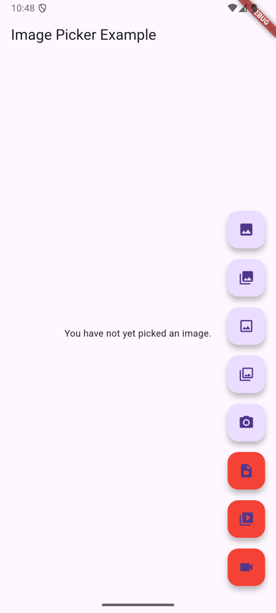

# Week 14A - Camera & Image Picker

## Overview

Today we use the `image_picker` package to take photos, record video, and pick media from the gallery. The plan:

1. Get the full pub.dev example running
2. Tour its eight buttons, so later you know where to find the code for each one
3. Build a small version from scratch
4. Lab time for Project 3

You'll need your Android emulator.

> **Web dev analogy:** Think of `image_picker` as the mobile equivalent of HTML's `<input type="file" accept="image/*">`. On the web, the browser handles file selection for you. Native apps don't get that shortcut, so this package bridges to the phone's camera and photo library instead.

---

## I. Get the Example Running

**Package:** https://pub.dev/packages/image_picker/

### Step 1: Create a New Flutter Project

```bash
flutter create camera_test
cd camera_test
```

### Step 2: Add the Packages

```bash
flutter pub add image_picker video_player mime
```

`image_picker` is the one we're here for. The example also uses `video_player` to play videos back and `mime` to tell images and videos apart. `pub add` runs `pub get` for you, so there's no extra step.

### Step 3: Copy the Example Code

1. Go to https://pub.dev/packages/image_picker/example
2. Copy the entire example
3. Replace everything in `lib/main.dart` with it

Red squiggles under an `import` mean a package isn't installed. Run `flutter pub add package_name`, or click the lightbulb and pick "Add dependency."

There's no Android setup to do. iOS needs a few lines in `Info.plist`; see [Platform Notes](#platform-notes) at the bottom.

---

## II. Give the Emulator a Camera

Camera settings live in **Android Studio's Device Manager**, not in the running emulator.

1. Open Android Studio and go to **Device Manager** (right sidebar, or View → Tool Windows → Device Manager)
2. Click the **pencil icon** (Edit) on your emulator
3. Find the **Camera** section and set **Front** and **Rear**:
   - **VirtualScene** (recommended): a fake 3D house you can walk around in
   - **Webcam0**: your computer's real webcam
   - Skip **Emulated**. It shows a green checkered space that isn't much use.
4. Click **Finish**, then start (or restart) the emulator

Webcam not in the list? See [Common Issues](#common-issues--solutions).

### Walking Around the Virtual Scene

Click inside the emulator window so it has keyboard focus, then hold **Option (Mac)** or **Alt (Windows)**:

- **WASD:** move forward/back/left/right
- **Mouse:** look around
- **Q/E:** move up/down

Fun extra: you can put your own picture on the dining room wall. In the running emulator, click **...** (Extended Controls) → **Camera** → **Virtual Scene** → **Add Image**, then walk into the dining room. Use a small image or a screenshot, since full-size photos may not show up.

---

## III. Tour the Example: Which Button Does What



The example puts eight buttons down the right side. Purple ones work with images, red ones with video. **Long-press any button to see its name.** That name is the button's `tooltip`, and it's also the fastest way to find its code.

Numbered top to bottom:

| # | Tooltip (long-press) | What it does | The call that does it |
|---|---|---|---|
| 1 | Pick image from gallery | One photo from the gallery | `pickImage(source: ImageSource.gallery)` |
| 2 | Pick multiple images | Several photos | `pickMultiImage()` |
| 3 | Pick item from gallery | One photo *or* one video | `pickMedia()` |
| 4 | Pick multiple items | Several photos and videos, mixed | `pickMultipleMedia()` |
| 5 | Take a photo | Opens the camera | `pickImage(source: ImageSource.camera)` |
| 6 | Pick video from gallery | One video | `pickVideo(source: ImageSource.gallery)` |
| 7 | Pick multiple videos | Several videos (it only plays the first) | `pickMultiVideo()` |
| 8 | Take a video | Records a clip, 10 seconds max | `pickVideo(source: ImageSource.camera)` |

Most apps only need 1 and 5, and those are the two we rebuild in Part IV.

### Before You Tap

- The purple buttons open a box first, titled "Add optional parameters" (max width, max height, quality). Leave it blank and tap **PICK**. It's there to show that the picker can shrink and compress images for you. The red buttons skip it.
- The gallery starts out empty, and photos from button 5 don't go into it: `image_picker` saves camera shots to your app's temporary cache. To have something to pick, open the emulator's own **Camera** app and take a few photos and a short video, or drag an image file from your computer onto the emulator window.
- Buttons 5 and 8 only show up on a device with a camera. Run the example in Chrome and they're gone. Both are wrapped in `if (_picker.supportsImageSource(ImageSource.camera))`, which is Collection If (more on that in Part IV).

### Finding the Code Behind a Button

1. Search `main.dart` (Cmd/Ctrl + F) for the button's tooltip, like `Take a photo`.
2. Look at its `onPressed`. It sets `isVideo`, then calls `_onImageButtonPressed()` with a source (camera or gallery) and sometimes `allowMultiple: true` or `isMedia: true`.
3. Cmd/Ctrl + click `_onImageButtonPressed` to jump to it. It's one long if/else that checks the flags in order: `isVideo`, then `allowMultiple`, then `isMedia`. The last `else` handles a plain single image. Follow the branch that matches your button.

For example, Take a photo sets `isVideo = false` and passes only `ImageSource.camera`. None of the checks match, so it lands in the last `else`, at `_picker.pickImage(source: source, ...)`. That call sits inside the optional-parameters box's callback, which is why the box pops up first.

### What You Can Skip

Most of the file handles edge cases. When you're reading it for ideas, you can skip:

- `_displayPickImageDialog`: the optional-parameters box
- `retrieveLostData` and the `FutureBuilder` in `build`: on Android the OS can close your app while the camera is open, and this gets the photo back when the app reopens
- `_playVideo`, `_buildInlineVideoPlayer`, `AspectRatioVideo`: video playback with `video_player`
- The `kIsWeb` checks: the web displays picked files a different way

Without those, the core is small: an `ImagePicker`, one pick call, and `setState` to show the result. That's what we build next.

---

## IV. Build a Simple Version (Code Along)

**Clear out your main.dart** (back it up first if you want to keep the full example).

### Step 1: Basic App Structure

Start with a fresh StatefulWidget:

```dart
import 'package:flutter/material.dart';
import 'package:image_picker/image_picker.dart';
import 'dart:io';

void main() {
  runApp(const MainApp());
}

class MainApp extends StatelessWidget {
  const MainApp({super.key});

  @override
  Widget build(BuildContext context) {
    return const MaterialApp(
      home: ImagePickerDemo(),
    );
  }
}

class ImagePickerDemo extends StatefulWidget {
  const ImagePickerDemo({super.key});

  @override
  State<ImagePickerDemo> createState() => _ImagePickerDemoState();
}

class _ImagePickerDemoState extends State<ImagePickerDemo> {
  @override
  Widget build(BuildContext context) {
    return Scaffold(
      body: Center(
        child: Column(
          mainAxisAlignment: MainAxisAlignment.center,
          children: [
            const Text('No image selected'),
          ],
        ),
      ),
    );
  }
}
```

### Step 2: Add State Variables

Add these at the top of your `_ImagePickerDemoState` class:

```dart
File? _image;
final ImagePicker _picker = ImagePicker();
```

`_image` stays null until a photo is taken. `_picker` is what opens the camera.

### Step 3: Create the Take Photo Method

Add this method to your state class:

```dart
Future<void> _takePhoto() async {
  final XFile? photo = await _picker.pickImage(source: ImageSource.camera);

  if (photo != null) {
    setState(() {
      _image = File(photo.path);
    });
  }
}
```

The camera takes time, so the method is `async`. The result is a nullable `XFile` because the user might cancel. `ImageSource.camera` opens the camera (`.gallery` opens the photo library), and `File(photo.path)` turns the result into something we can display.

### Step 4: Add the Button

In your Column children, add a button that calls the method:

```dart
ElevatedButton(
  onPressed: _takePhoto,
  child: const Text('Take Photo'),
),
```

### Step 5: Display the Image - Collection If

We want to show either the image OR the "no image" text.

**Replace** `const Text('No image selected')` with:

```dart
if (_image != null)
  Image.file(_image!, height: 300)
else
  const Text('No image selected'),
```

### New Concept: Collection If

This `if/else` directly inside the `children` list is called **Collection If**, a Dart language feature.

```dart
children: [
  if (condition)
    WidgetA()
  else
    WidgetB(),

  // Regular widgets continue...
  SizedBox(height: 20),
]
```

It reads cleaner than a ternary (`condition ? WidgetA() : WidgetB()`), and your UI code directly reflects the state. Dart also has **Collection For** for building lists.

**Is this breaking separation of concerns?** Not really. This is idiomatic Flutter: you're not doing business logic, just deciding what to render based on state, which is exactly the widget's job.

### Bonus Challenge

If you finish early, try adding a second button for `_pickFromGallery()` that uses `ImageSource.gallery` instead of `ImageSource.camera`. That's button 1 from the example.

---

## V. Lab Time

Use the remaining class time to work on **Project 3**. I'm available for questions and troubleshooting.

**Project 3 Reminders:**
- Final submission due during Finals Week
- Make sure to implement custom icons and splash screens (Week 13B)
- Test on emulator AND physical device if possible

**Heads-up:** there will be an optional Zoom session during finals week where you can demo your Project 3 app for bonus points. Details next class, along with course evaluations.

---

## Common Issues & Solutions

### "No camera available"
- Emulator camera not set up (see Part II)
- Permissions not granted: check the app's settings

### The gallery picker is empty
- Camera shots from `image_picker` don't go into the gallery. See "Before You Tap" in Part III.

### Red squiggles on imports
- Package not installed: run `flutter pub add package_name`

### Build error mentioning `minSdkVersion`
- Older Flutter versions start new projects on a lower Android version than `image_picker` needs. In `android/app/build.gradle.kts` (or `build.gradle`), set the `minSdk` line to `24`.

### Video not playing
- `video_player` package not installed
- Video format not supported

### Webcam not showing in emulator options
- Another app is using the webcam (close Zoom, Teams, etc.)
- Check that your webcam works in other apps first
- Try restarting Android Studio / emulator
- Update Android SDK tools

---

## Platform Notes

**Android:** nothing to add. Current Flutter projects already meet `image_picker`'s minimum Android version.

**iOS:** I've only tested this on Android, but the package docs say to add these to `ios/Runner/Info.plist`, inside the `<dict>` tag:

```xml
<key>NSCameraUsageDescription</key>
<string>This app needs camera access to take photos and videos</string>
<key>NSMicrophoneUsageDescription</key>
<string>This app needs microphone access to record videos</string>
<key>NSPhotoLibraryUsageDescription</key>
<string>This app needs photo library access to select images</string>
```

---

## Resources

- **image_picker package:** https://pub.dev/packages/image_picker
- **video_player package:** https://pub.dev/packages/video_player
- **Flutter Camera Cookbook:** https://docs.flutter.dev/cookbook/plugins/picture-using-camera
- **Android Emulator Camera Docs:** https://developer.android.com/studio/run/emulator#extended

---

## Going Further: Where This Goes in Real Apps

The demo stops at showing the image on screen. In a real app, picking the photo is usually step one of a bigger flow: profile pictures, social posts, receipt or check capture, marketplace listings (`pickMultiImage()` grabs several photos at once), plant or food ID apps that send the image to an ML service, and screenshots attached to support tickets.

The typical production pipeline:

```
image_picker → XFile
  → (optional) compress / resize
  → http MultipartRequest
  → POST to server
  → server saves to S3 / Cloudinary / Firebase Storage
  → URL stored in a database
```

Why not just keep the local file? The cache path the OS gives us isn't durable. It can be evicted under storage pressure, it's wiped on uninstall, and it doesn't sync across a user's devices. The server (or cloud storage) becomes the source of truth, and the local path is just how the bytes got there.

To keep it local instead (say, a journaling app that works offline), copy the file from the cache into the app's documents directory with the `path_provider` package, then save that path in `SharedPreferences` or a database.
