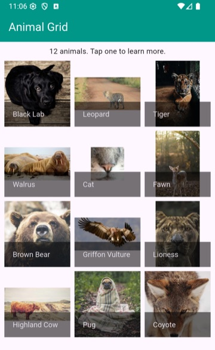
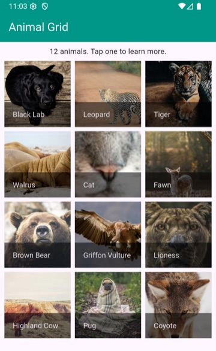

# Week 8B - GridView with Real Images

## In-Class Participation

> **Where's the repo link?** Participation links are not inside the weekly folders. In myCourses, go to **Content → GitHub Participation Links** and open the **8B** link. Accept it, then clone your own repo (its name ends in your GitHub username) and follow along in class. Don't fork the starter: work pushed anywhere else won't count.

**New repo today.** Pushing the starter back untouched does not count. Your commit needs to show today's work: a `GridView.builder` that gets its `itemCount` and its items from the `animals` list, with the photos showing. The popup at the end is welcome but not required. Push before our next class, **Tuesday Oct 20**.

**Nothing to install today.** The photos are already in `assets/animals/`, and `pubspec.yaml` is already set up to load them. Nothing goes over the network either, so the emulator, Chrome, and desktop all work.

Setup broken? Pasting your `main.dart` into the repo on GitHub.com still counts. See [Participation Repos](../documents/participation.md) for all three ways to submit.

> **📖 Quick Reference:** See the [GridView Reference](../reference/widgets/gridview-basics.md) and the [Images Reference](../reference/widgets/images-assets.md) for more examples and common mistakes.

## Today

1. **Project 2 kickoff.** Read the [Project 2 spec](../projects/p2_web_service_application.md) and start browsing APIs. The proposal is due **Friday Oct 23** (check MyCourses for the exact time).
2. **Build a grid of photos** from a list of animals. That's the rest of these notes.
3. **Lab 04 work time.** Lab 04 is due **Sunday Oct 18**, and its last part is a grid.

---

## I. The Starter

The starter has the app bar, one line of text, and a list called `animals` already filled in:

```dart
List<Map<String, dynamic>> animals = [
  {
    'name': 'Black Lab',
    'image': 'assets/animals/black_lab.jpg',
    'fact': 'Labs were bred to fetch for fishermen, which is why so many of them love the water.',
    'photographer': 'André Spieker',
  },
  // ...11 more animals
];
```

It's hardcoded, but look at the shape: a List of small Maps, the same shape as the `cartsList` you built in 7B. Pretend it came back from an API and we already cleaned it up. Each animal has more fields than the grid will show. That matters at the end.

The photos are in `assets/animals/`, and the `assets:` block in `pubspec.yaml` loads them (same setup as 4B). They're different shapes on purpose: some wide, some tall, some square, and one very small.

---

## II. GridView.count: You Write Every Child

**Where:** `TODO Step 2`, at the bottom of the Column's `children`.

```dart
Expanded(
  child: GridView.count(
    crossAxisCount: 3,
    children: [
      Text("Black Lab"),
      Text("Leopard"),
      Text("Tiger"),
    ],
  ),
),
```

`crossAxisCount` is the number of columns. The `Expanded` is there for the same reason it was around the ListView in 7B: a grid inside a Column has to be told how much room it gets, or you get a red "unbounded height" screen.

`GridView.count` makes you write out every child. Three animals is three lines. Twelve is twelve. An API that sends back 50 results is not happening. That's what the builder is for.

---

## III. GridView.builder: One Cell per Item in Your List

Replace the whole `GridView.count(...)` with this, keeping the `Expanded` around it:

```dart
child: GridView.builder(
  gridDelegate: SliverGridDelegateWithFixedCrossAxisCount(
    crossAxisCount: 3,
  ),
  itemCount: animals.length,
  itemBuilder: (context, index) {
    return Text(animals[index]['name']);
  },
),
```

- **`itemCount`** is how many cells to build. Set it from your list, so the grid grows and shrinks with the data.
- **`itemBuilder`** runs once per cell and hands you the `index`. Use it to pull that item out of the list.
- **`gridDelegate`** says how the grid is laid out. Yes, `SliverGridDelegateWithFixedCrossAxisCount` is a mouthful. "Sliver" means scrollable, and "fixed cross axis count" means a fixed number of columns.

The last two are the same as `ListView.builder` in 7B. The grid just lays the cells out in columns.

---

## IV. Real Images Come in Every Shape

Swap the `Text` for the photo:

```dart
itemBuilder: (context, index) {
  return Image.asset(animals[index]['image']);
},
```

And add some space between the cells, inside the `gridDelegate`:

```dart
crossAxisCount: 3,
crossAxisSpacing: 8,
mainAxisSpacing: 8,
```

Here's what you get (shown with the name labels from Section V already added):



It looks broken, but the grid is doing its job. Every cell is the same size, and each photo shrinks until it fits inside its cell, keeping its own shape. Wide photos end up as strips, tall ones get empty space on the sides, and the tiny cat never grows at all.

Real images do this. Whatever API you use in Project 2 will hand you images in all kinds of shapes, and GIPHY's do too.

### The `fit` property

`fit:` controls how an image fills the space it's given. If you've used `object-fit` in CSS, it's the same idea.

```dart
return Image.asset(
  animals[index]['image'],
  fit: BoxFit.cover,
);
```

| `fit:` | CSS equivalent | What happens |
|---|---|---|
| *(nothing)* | | Shrinks to fit, never grows, keeps its shape. What you saw above. |
| `BoxFit.fill` | `object-fit: fill` | Stretches to fill the cell. Animals come out squashed or skinny. |
| `BoxFit.contain` | `object-fit: contain` | The whole photo, as big as it fits, with gaps. |
| `BoxFit.cover` | `object-fit: cover` | Fills the cell and crops whatever doesn't fit. |



`cover` is what most apps use, but it has a cost. Look for the highland cow. It was standing at the edge of a wide photo, and cover cropped it right out. `contain` would keep it, and leave gaps. There's no setting that wins every time. You pick the tradeoff that suits your images.

The cat is blurry under `cover` because the photo is only 64 pixels wide, and cover can't invent pixels. If your API offers images in more than one size, ask for one that's big enough.

### The cell shape is a choice too

By default every cell is square. `childAspectRatio` in the `gridDelegate` changes that:

```dart
childAspectRatio: 3 / 4,   // width / height, so this makes taller cells
```

Showing movie posters? Something like `2 / 3` will crop a lot less.

Plain `GridView` always gives every cell in a row the same height. The Pinterest look, where each photo keeps its own height, needs a package. Ask me first if you want to try that for Project 2.

---

## V. GridTile for Structured Items

`GridTile` gives a cell a `header` and a `footer` that float on top of its `child`. Put the photo in the `child` and the name in the `footer`:

```dart
return GridTile(
  footer: GridTileBar(
    backgroundColor: Colors.black54,
    title: Text(animals[index]['name']),
  ),
  child: Image.asset(
    animals[index]['image'],
    fit: BoxFit.cover,
  ),
);
```

`GridTileBar` is a bar made for exactly this spot, with white text by default. The background is `black54`, a half-transparent black, so the name is readable over a white walrus and a black lab alike.

**Shortcut:** put your cursor on `Image.asset`, press **Cmd+.** (Mac) or **Ctrl+.** (Windows), and choose **Wrap with widget**. Type `GridTile` and VS Code does the brackets for you. Then add the `footer`.

---

## VI. Tap for the Full Result

Project 2 requires a "teaser first, then the full result" layout ([P2 spec, Design & Interaction](../projects/p2_web_service_application.md#b-design--interaction)). The grid is the teaser: a picture and a name. Tapping one opens a popup with everything else. Here's that pattern on the animals.

### 1. Make each tile tappable

Wrap the `GridTile` in a `GestureDetector` (same Wrap with widget shortcut):

```dart
return GestureDetector(
  onTap: () {
    debugPrint(animals[index]['name']);
  },
  child: GridTile(
    // ...the GridTile from Section V
  ),
);
```

Tap the tiger and you should see `Tiger` in the Debug Console.

### 2. A function that opens the popup

Put this above `build()`, where the `TODO Step 9` comment is. It's the `showDialog` and `AlertDialog` from 4B:

```dart
/// Shows the full record for one animal in a popup.
void showAnimal(Map<String, dynamic> animal) {
  showDialog(
    context: context,
    builder: (context) {
      return AlertDialog(
        title: Text(animal['name']),
      );
    },
  );
}
```

Then change the `onTap` to call it, passing the animal that was tapped:

```dart
onTap: () {
  showAnimal(animals[index]);
},
```

### 3. Fill in the popup

Under the `title:`, add a `content:` that shows the whole photo and the fact:

```dart
content: Column(
  mainAxisSize: MainAxisSize.min,
  children: [
    Image.asset(animal['image']),
    SizedBox(height: 12),
    Text(animal['fact']),
  ],
),
```

There's no `fit:` here, so the popup shows the whole photo while the grid shows a crop. Tap the highland cow and you'll find it. Tap the cat and you'll see how small that photo really is. `mainAxisSize: MainAxisSize.min` keeps the Column only as tall as its contents, so the popup doesn't fill the screen.

### 4. Make it look finished

A photo credit under the fact:

```dart
SizedBox(height: 12),
Text(
  "Photo: ${animal['photographer']} on Unsplash",
  style: TextStyle(fontSize: 12, color: Colors.grey),
),
```

And a Close button. This goes inside the `AlertDialog`, after the `content:` Column's closing `),`:

```dart
actions: [
  TextButton(
    onPressed: () {
      Navigator.pop(context);
    },
    child: Text("Close"),
  ),
],
```

Tapping outside the popup also closes it, but a button makes that obvious.

---

## VII. Widget Inspector

As your widget tree grows, the Widget Inspector helps you see where things are.

1. Click the inspector icon in the debug toolbar (or open DevTools → Inspector).
2. Click something in the running app.
3. VS Code shows where that widget sits in the tree, with its boundary box drawn on screen.

When something looks wrong in a deeply nested tree, this tells you which widget is causing it, instead of hunting through 200 lines. Turn it off when you're done, or it takes over your taps.

---

## VIII. Help for Lab 04 and Project 2

### macOS Network Permission

Only for running your app as a **macOS desktop app**. Android, Windows, and Chrome don't need this. The Lab 04 starter already has it turned on, so you'll only need it for a project you created yourself, like Project 2.

The error looks like this:

```
ClientException with SocketException: Connection failed
(OS Error: Operation not permitted, errno = 1)
```

macOS blocks network requests from apps unless they ask permission. Add these two lines to **both** `macos/Runner/DebugProfile.entitlements` and `macos/Runner/Release.entitlements`, just before the closing `</dict>`:

```xml
<key>com.apple.security.network.client</key>
<true/>
```

Then stop the app and run it again. Hot reload won't pick this up.

### Lab 04's grid

Part 3 of [Lab 04](../labs/lab-04-gif-finder.md) asks for a grid of GIFs. Everything in Sections III through V applies, along with the [GridView Reference](../reference/widgets/gridview-basics.md). Showing an image from a URL is `Image.network`, which takes the same `fit:`.

---

## Common Issues & Solutions

| Problem | Solution |
|---------|----------|
| "Unable to load asset: assets/animals/..." | Make sure you opened the folder that contains `pubspec.yaml`. If you changed `pubspec.yaml`, stop the app and run it again (hot reload doesn't pick up new assets). |
| Red screen: "Vertical viewport was given unbounded height" | Wrap the `GridView` in `Expanded`. |
| Photos squished, stretched, or surrounded by gaps | That's `fit:`. See the table in Section IV. |
| One photo is blurry | That's the cat. It's 64 pixels on purpose. |
| Only some items show up, or the grid scrolls forever | Set `itemCount` to your list's length. |
| Tapping does nothing | The `GestureDetector` has to wrap the whole `GridTile`, and its `onTap` has to call `showAnimal`. |
| "Wrap with widget" left the word `widget` in my code | Type the widget's name over it, like `GridTile`. |
| The popup fills the whole screen | Add `mainAxisSize: MainAxisSize.min` to the popup's Column. |

---

## What You Should Be Working On

- **Lab 04, due Sunday Oct 18.** Part 3 is the grid. Today's notes plus the [GridView Reference](../reference/widgets/gridview-basics.md) cover it.
- **Project 2 proposal, due Friday Oct 23.** Pick an API from the [Recommended APIs](../projects/p2_web_service_application.md#recommended-apis), or check your own against the [four things in the spec](../projects/p2_web_service_application.md#picking-your-own-api) before you write the proposal.
- **Push today's repo** before class on Tuesday Oct 20.

---

## Looking Ahead

Next class (Week 9A) we'll cover:
- Data persistence with `shared_preferences`
- Opening external apps with `url_launcher`
- Caching images with `cached_network_image`

---

## Need Help?

- **GridView layout:** the [GridView Builder Visual Tool](https://jptweb.github.io/GridView-Builder-For-Flutter/gridview-builder-all-in-one.html) lets you try column counts, spacing, and aspect ratios before writing code
- **Flutter docs:** [GridView](https://api.flutter.dev/flutter/widgets/GridView-class.html) and [BoxFit](https://api.flutter.dev/flutter/painting/BoxFit.html), both with pictures
- **Lab questions:** post in Slack with the exact error message
- Remember: `flutter clean` before you zip and submit anything

---

Photos from [Unsplash](https://unsplash.com) by way of [picsum.photos](https://picsum.photos), free to use under the Unsplash License. Each photographer is credited in the starter's `animals` list.

---
---
| <-- Previous Unit | Home | Next Unit -->
| --- | --- | ---
| [**Week 7B Notes**](7B.md) | [**IGME-340 Home**](../) | [**Week 9A Notes**](9A.md)
